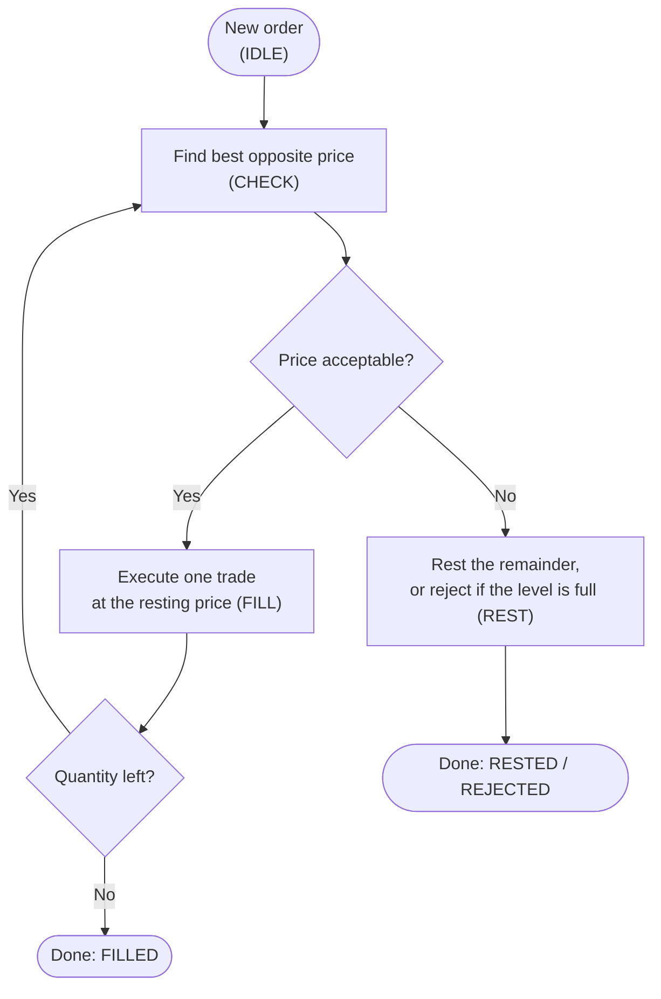
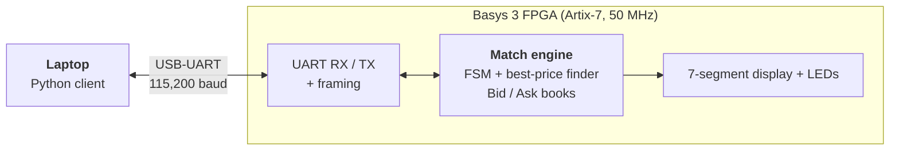
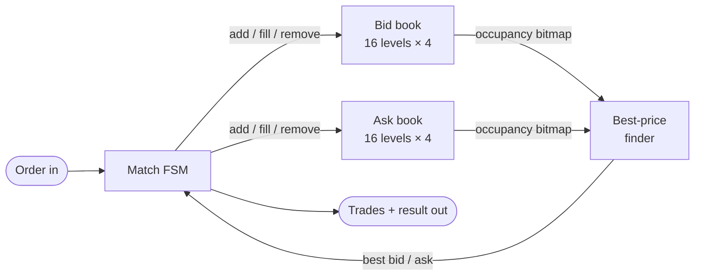
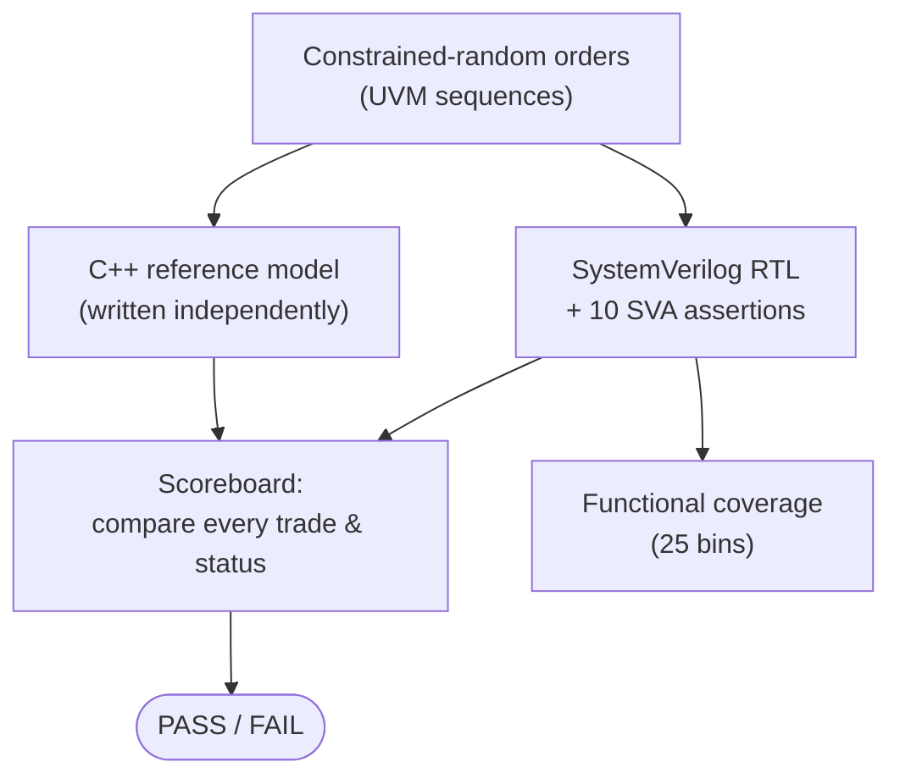

# FPGA Order Matching Engine

A hardware stock-exchange order-matching engine built in SystemVerilog and implemented on a Digilent **Basys 3 (Artix-7)** FPGA.

The design was verified using **UVM**, **SystemVerilog Assertions (SVA)** and **functional coverage** against an independently developed **C++ reference model**, then tested on the physical FPGA.

**Highlights**

- **Designed a hardware order-matching engine** implementing price-time priority, partial fills, and FIFO order queues using synthesizable SystemVerilog.
- **0 mismatches** vs the C++ model: 19,500 random orders in simulation (21/21 regression runs) and **3,000 random orders on the FPGA**.
- **100% functional coverage** across 25 defined coverage bins, achieved after identifying and fixing a test stimulus bug.
- **10 SVA properties**, one of which caught a planted bug the scoreboard could not see.
- **Measured FPGA performance:** averaged 4.63 cycles (~93 ns) per order at 50 MHz, matching simulation results.
- **Achieved FPGA timing closure at 50 MHz** after identifying a critical path that failed timing at 100 MHz, while preserving functional correctness.

### Demo Videos

- ▶️ [Live order matching on the FPGA](https://youtube.com/shorts/pfn8-RwJwjo)
- ▶️ [Hardware check: 1,000 random orders vs the C++ reference model](https://youtube.com/shorts/L8hA5_o1Alo)

---

## What it does

Traders send orders such as _BUY 10 @ 9_ or _SELL 4 @ 9_. The engine keeps an order book of waiting orders and matches every new order that crosses the other side:

1. **Price priority:** a buy matches the lowest sell first; a sell matches the highest buy first.
2. **Time priority:** at the same price, the oldest order fills first.
3. **Trade price** = the price of the order already waiting in the book.
4. **Partial fills:** an order keeps matching until it is fully filled or no acceptable opposite orders remain. Any remainder rests in the book.
5. **Reject:** if the remainder's price level is already full, the order is rejected.

**Scope:** 1 instrument, limit orders only, 16 price levels per side (prices 0–15), 4 orders per level, 8-bit quantities and IDs.

### How an order is matched



### Price-time priority, by example

Incoming **BUY 10 @ 10** against this sell side of the book:

| Sell price | Queue (oldest first) | What happens                                                                |
| ---------- | -------------------- | --------------------------------------------------------------------------- |
| 8          | A (4) → B (3)        | ✔ Best price first: A fills 4 @ 8, then B fills 3 @ 8                       |
| 9          | C (5) → D (2)        | ✔ Next price: C fills the last 3 @ 9 (2 stay in the book); D waits behind C |
| 11         | E (6)                | ✘ Above the buyer's limit of 10: not touched                                |

Result: 3 trades (4 @ 8, 3 @ 8, 3 @ 9) and the buy is FILLED. Each trade uses the resting order's price.

---

## System



_One micro-USB cable carries power, programming and the UART._

**Message format** (every field is 1 byte):

| Direction  | Bytes                        | Meaning                                                    |
| ---------- | ---------------------------- | ---------------------------------------------------------- |
| PC → board | `A5` id side price qty       | One order (`0xA5` = header byte)                           |
| board → PC | `T` buy_id sell_id price qty | One per trade                                              |
| board → PC | `D` id status cycles         | Once per order: RESTED / FILLED / REJECTED + engine cycles |

### Inside the match engine



_The FSM reads the best opposite price from the best-price finder, then adds, fills or removes orders in the books. Each book reports which price levels are occupied through a 16-bit bitmap._

### Blocks

- **`book_side`** (one for bids, one for asks): 16 price levels, each a 4-entry FIFO of `{id, qty}`, plus a 16-bit bitmap showing which levels are non-empty.
- **`best_price`**: priority encoders on the bitmaps give the best bid (highest) and best ask (lowest) in the same cycle.
- **`match_engine`**: a 5-state FSM (`IDLE → CHECK ⇄ FILL → REST → DONE`; a fully filled order skips REST). One trade per FILL cycle, with **valid/ready** handshakes on the order input and the trade output.
- **`uart_rx` / `uart_tx`**: 8N1 UART written from scratch (2-flip-flop synchronizer, mid-bit sampling, glitch rejection).
- **`order_rx`**: waits for the `0xA5` header and assembles the next 4 bytes into an order.
- **`report_tx`**: turns trades and results into bytes. Because the UART is slow, it back-pressures the engine through `trade_ready`.
- **Clock:** an MMCM turns the board's 100 MHz oscillator into the 50 MHz design clock (see [Engineering Challenges](#engineering-challenges)).

---

## Verification



The same orders go to the RTL and to the C++ model, and the scoreboard compares every trade and status. Assertions check internal rules every cycle; coverage measures which scenarios were actually tested.

| Layer                    | What                                                                                                                    | Result                                                                       |
| ------------------------ | ----------------------------------------------------------------------------------------------------------------------- | ---------------------------------------------------------------------------- |
| C++ reference model      | Written test-first; directed tests + 20,000-order random invariant test                                                 | Caught 1 model bug the directed tests missed                                 |
| Unit testbenches         | `tb_book` (9 directed + 3,000 random ops, ~375,000 checks), `tb_engine` (9 directed + 4,000 random orders)              | Pass                                                                         |
| UVM testbench            | UVM driver, monitor, C++ scoreboard, constrained-random testing, back-pressure, and 7 test scenarios                    | **19,500 orders, 10,834 trades, 0 mismatches**                               |
| Assertions (SVA)         | 10 properties attached with `bind`: book rules (B1–B4) and engine rules (E1–E6)                                         | 0 failures on the correct design                                             |
| Functional coverage      | 7 coverpoints/crosses, 25 bins                                                                                          | **100%** (`all_scenarios_test`, seeds 1–3)                                   |
| Regression               | `scripts/run_regression.py`: 7 tests × 3 seeds, PASS/FAIL table, CI-style exit code                                     | **21/21 passed**                                                             |
| UART + board-level sim   | `tb_uart` (bit-exact wire check, 256-byte loopback, glitch); `tb_board` (300 orders sent as UART bits vs the C++ model) | Pass                                                                         |
| **Hardware-in-the-loop** | `scripts/board_client.py`: 3 × 1,000 random orders over USB to the FPGA, checked against the same C++ model             | **3,000 orders, 2,164 trades, 0 mismatches; 3,000/3,000 cycle counts match** |

### Testing the testbench

To prove the testbench can catch real bugs, two faults were deliberately added to the RTL and then reverted.

| Injected bug                         | Caught by          | Result                                       |
| ------------------------------------ | ------------------ | -------------------------------------------- |
| Trades executed at the wrong price   | Scoreboard         | **487 mismatches** across 1,000 orders       |
| Order pushed into a full price level | SVA assertion (B2) | **511 violations**; scoreboard detected none |

**Takeaway:** the scoreboard catches wrong outputs; assertions catch internal rule violations that never show up at the outputs.

### Coverage closure

Functional coverage initially reached 95.2% (one bin never hit), revealing that medium-sized orders were never generated. After fixing the test stimulus, coverage reached 100% across 25 defined coverage bins.

---

## FPGA Implementation & Performance

Built with Vivado 2026.1 for the Basys 3.

| Metric                      | Result                                                                                                       |
| --------------------------- | ------------------------------------------------------------------------------------------------------------ |
| Resource use                | 1,359 LUTs (7%), 2,366 flip-flops (6%)                                                                       |
| Timing                      | Met at **50 MHz**, no failing paths                                                                          |
| Engine latency              | **4.63 cycles/order** average (~93 ns) on the random mix                                                     |
| Estimated engine throughput | **~10.8 million orders/s** at 50 MHz, based on average cycles per order (assumes orders arrive back-to-back) |
| Measured end-to-end (USB)   | **62 orders/s**                                                                                              |

### Engineering Challenges

**Timing:** static timing analysis showed a critical path that failed at 100 MHz. Running the design at 50 MHz (via the MMCM) met timing with no change to behaviour.

**USB bottleneck:** the engine itself is fast; the 62 orders/s end-to-end rate comes from the host. The Python client sends one order and waits for its reply before sending the next, so every order pays a full USB-serial round trip. 62 orders/s ≈ one order per 16 ms, which matches the default latency timer of the board's FTDI USB-serial chip. The UART wire alone could carry ~2,300 orders/s (115,200 baud ÷ 10 bits per byte ÷ 5 bytes per order).

### Limitations

- One instrument, limit orders only: no cancel, modify or market orders.
- Fixed book size (16 levels × 4 orders per side); orders beyond that are rejected.
- Throughput above is engine-only; the UART link is the real-world limit.

---

## Repository

```
rtl/       book_side, best_price, match_engine, uart_rx, uart_tx, order_rx, report_tx, seg7_display, top
tb/        directed/ (tb_book, tb_engine, tb_uart, tb_board), uvm/ (UVM env, tests, SVA, coverage)
model/     C++ reference order book (ref_book), ref_runner, model tests
scripts/   run_*.bat, run_regression.py, board_client.py, build_fpga.bat, program_fpga.bat
fpga/      basys3.xdc (pins + clock), build.tcl, program.tcl
docs/      regression_results.txt
```

## How to Run (Windows)

**Requirements**

- Vivado 2026.1 (synthesis, implementation, and the xsim simulator with UVM)
- Python 3 with pyserial (`pip install pyserial`)
- MSYS2 UCRT64 (`g++`) for the C++ model
- Digilent Basys 3 board (hardware tests only)

**Setup**

1. Open Command Prompt and run Vivado's `settings64.bat` so the Vivado tools are on your PATH.
2. Build the C++ reference model once:

```bat
g++ -std=c++14 -Wall -static -o model/ref_runner model/ref_runner.cpp model/ref_book.cpp
```

**Commands**

| Task                                             | Command                                                                  |
| ------------------------------------------------ | ------------------------------------------------------------------------ |
| Run unit tests                                   | `scripts\run_book.bat`, `scripts\run_engine.bat`, `scripts\run_uart.bat` |
| Run one UVM test                                 | `scripts\run_uvm.bat all_scenarios_test 1`                               |
| Run full regression (21 runs: 7 tests × 3 seeds) | `python scripts\run_regression.py --seeds 3`                             |
| Run board-level simulation                       | `scripts\run_board_sim.bat`                                              |
| Build and program the FPGA                       | `scripts\build_fpga.bat`, then `scripts\program_fpga.bat`                |
| Check 1,000 orders on the FPGA                   | `python scripts\board_client.py --port COM5 check --orders 1000`         |
| Send orders by hand                              | `python scripts\board_client.py --port COM5 manual`                      |

**On the board:** connect the Basys 3 over USB and press the centre button to reset before testing. Replace `COM5` with your board's serial port (Device Manager → Ports). The 7-segment display shows the best bid and best ask; the left 8 LEDs count orders and the right 8 count trades, in binary.
