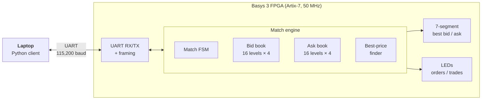

# FPGA Order Matching Engine

A hardware stock-exchange matching engine in SystemVerilog, running on a Digilent **Basys3 (Artix-7)**, verified with a **UVM** testbench, **SVA** assertions and **functional coverage** against an independently written **C++ reference model**, then checked again on the real chip (hardware-in-the-loop).

**Highlights**

- **0 mismatches** vs the C++ model: 19,500 random orders in simulation (21/21 regression runs) and **3,000 random orders on the FPGA**
- **100% functional coverage** (25-bin model), reached after coverage exposed a stimulus bug
- **10 SVA properties**, one of which caught a planted bug the scoreboard could not see
- **4.63 cycles per order**, identical in simulation and on the chip (on-chip cycle counters)
- **1,072 flip-flops per order-book side**: predicted from the architecture, matched exactly by Vivado
- Timing closed at **50 MHz** after diagnosing a 100 MHz critical path (WNS −2.262 ns → +4.853 ns)

<!-- Demo video: add your link here, e.g. [▶ 60-second demo](https://youtu.be/...) -->

---

## What it does

Traders send orders such as _BUY 10 @ 9_ or _SELL 4 @ 9_. The engine keeps an order book of waiting orders and matches every order that crosses the other side:

1. **Price priority:** a buy matches the lowest sell first; a sell matches the highest buy first.
2. **Time priority:** at the same price, the oldest order fills first.
3. **Trade price** = the price of the order already waiting in the book.
4. A partly filled order **rests** in the book with its remaining quantity.
5. If its price level is full, the order is **rejected**.

Scope: 1 instrument, 16 price levels per side, 4 orders per level, 8-bit quantities and IDs, limit orders.

### How an order is matched


### Price-time priority, by example

Incoming **BUY 10 @ 10** against this sell side of the book:

| Sell price | Queue (oldest first) | What happens                                                                |
| ---------- | -------------------- | --------------------------------------------------------------------------- |
| 8          | A (4) → B (3)        | ✔ Best price first: A fills 4 @ 8, then B fills 3 @ 8                       |
| 9          | C (5) → D (2)        | ✔ Next price: C fills the last 3 @ 9 (2 stay in the book); D waits behind C |
| 11         | E (6)                | ✘ Above the buyer's limit of 10: not touched                                |

Result: 3 trades (4 @ 8, 3 @ 8, 3 @ 9), the buy is FILLED. Each trade takes the resting order's price.

---

## System



_One micro-USB cable carries power, programming and the UART. The order books are inside the match engine._

| Direction  | Bytes                        | Meaning                                                    |
| ---------- | ---------------------------- | ---------------------------------------------------------- |
| PC → board | `A5` id side price qty       | One order (`A5` = header byte)                             |
| board → PC | `T` buy_id sell_id price qty | One per trade                                              |
| board → PC | `D` id status cycles         | Once per order: RESTED / FILLED / REJECTED + engine cycles |

### Blocks

- **`book_side`** (×2): 16 price levels × 4-entry FIFO of `{id, qty}` per side, plus a 16-bit occupancy bitmap.
- **`best_price`**: priority encoders on the bitmaps → best bid (highest) and best ask (lowest) in the same cycle.
- **`match_engine`**: a 5-state FSM, `IDLE → CHECK ⇄ FILL → REST → DONE`, one trade per FILL, with **valid/ready** handshakes on the order input and the trade output.
- **`uart_rx` / `uart_tx`**: 8N1 UART written from scratch (2-flip-flop synchronizer, mid-bit sampling, glitch rejection).
- **`report_tx`**: turns trades and results into bytes. The slow UART back-pressures the engine through `trade_ready`.
- **Clock:** an MMCM turns the board's 100 MHz oscillator into the 50 MHz design clock (see Implementation for why).

---

## Verification


The same orders go to the RTL and to an independently written C++ model; the scoreboard compares every trade and status. Assertions check internal rules every cycle, and coverage measures which scenarios happened.

| Layer                    | What                                                                                                                                                                     | Result                                                                       |
| ------------------------ | ------------------------------------------------------------------------------------------------------------------------------------------------------------------------ | ---------------------------------------------------------------------------- |
| C++ reference model      | Written test-first; directed tests + 20,000-order random invariant test                                                                                                  | Caught 1 model bug the directed tests missed                                 |
| Unit testbenches         | `tb_book` (9 directed + 3,000 random ops, ~375,000 checks), `tb_engine` (9 directed + 4,000 random orders)                                                               | Pass                                                                         |
| UVM testbench            | Constrained-random sequences, driver, monitor, scoreboard vs the C++ model, 7 tests (random, calm, frantic, whale, one-sided, full levels, all scenarios), back-pressure | **19,500 orders, 10,834 trades, 0 mismatches**                               |
| Assertions (SVA)         | 10 properties attached with `bind`: book contract (B1–B4) and engine rules (E1–E6)                                                                                       | 0 failures on the correct design                                             |
| Functional coverage      | 7 coverpoints/crosses, 25 bins                                                                                                                                           | **100%** (`all_scenarios_test`, seeds 1–3)                                   |
| Regression               | `scripts/run_regression.py`: 7 tests × 3 seeds, PASS/FAIL table, CI-style exit code                                                                                      | **21/21 passed**                                                             |
| UART + board-level sim   | `tb_uart` (bit-exact wire check, 256-byte loopback, glitch); `tb_board` (300 orders as UART bits vs the C++ model)                                                       | Pass                                                                         |
| **Hardware-in-the-loop** | `scripts/board_client.py`: 3 × 1,000 random orders over USB to the FPGA, same C++ model                                                                                  | **3,000 orders, 2,164 trades, 0 mismatches; 3,000/3,000 cycle counts match** |

### Testing the testbench

A pass only means something if the same test can fail, so bugs were **planted** in the RTL and then reverted:

| Planted bug                                                        | Scoreboard                                 | Assertions                                                  |
| ------------------------------------------------------------------ | ------------------------------------------ | ----------------------------------------------------------- |
| Trade at the incoming order's price instead of the resting order's | **487 mismatches** / 1,000 orders          | n/a                                                         |
| FSM pushes into a full price level (silently ignored by the book)  | **0 mismatches**: invisible at the outputs | **B2 fired 511 times**, naming the exact cycle and instance |

### Coverage closure

`all_scenarios_test` stopped at 95.2%. The per-coverpoint report showed medium order sizes were **never generated**: a soft constraint (`qty inside {[1:8]}`) isn't dropped unless it conflicts, and `constraint_mode(0)` didn't release it in Vivado. The scoreboard can't see a scenario that never happens; coverage can. The sequences now pick sizes directly → **100%**.

---

## Implementation (Vivado 2026.1, xc7a35tcpg236-1)

|                          | Result                                                                                                             |
| ------------------------ | ------------------------------------------------------------------------------------------------------------------ |
| Flip-flops per book side | **1,072** (predicted: 16 levels × 4 slots × 16 bits + 16 × 3-bit counts = 1,072)                                   |
| Whole design             | 1,359 LUTs (7%), 2,366 flip-flops (6%), 1 MMCM                                                                     |
| Timing at 100 MHz        | **Failed**, WNS −2.262 ns: count → best price → FSM → book enable, 12 logic levels, 81% routing delay (fanout 120) |
| Timing at 50 MHz (MMCM)  | **Met**, WNS +4.853 ns, 0 failing endpoints                                                                        |

Next steps for 100 MHz: register the FSM decision (pipelining), replicate the high-fanout enable, or use a pointer-based FIFO so a pop doesn't touch every slot.

## Performance

|                              |                                                                                                   |
| ---------------------------- | ------------------------------------------------------------------------------------------------- |
| Engine cycles per order      | RESTED/REJECTED = 4 + 2 × trades, FILLED = 2 + 2 × trades; **average 4.63** (simulation and chip) |
| Engine capacity at 50 MHz    | ≈ 10.8 million orders/s                                                                           |
| Measured end to end over USB | **62 orders/s**                                                                                   |

The bottleneck is the host link, not the engine, and not even the UART bit rate (~1 ms per order): it's **round-trip latency**. The USB-serial bridge buffers data for up to ~16 ms and the script waits for each reply. Batching orders would be the first fix.

---

## Repository

```
rtl/       book_side, best_price, match_engine, uart_rx, uart_tx, order_rx, report_tx, seg7_display, top
tb/        directed/ (tb_book, tb_engine, tb_uart, tb_board), uvm/ (UVM env, tests, SVA, coverage)
model/     C++ reference order book (ref_book), ref_runner, model tests
scripts/   run_*.bat, run_regression.py, board_client.py, build_fpga.bat, program_fpga.bat
fpga/      basys3.xdc (pins + clock), build.tcl, program.tcl
docs/      regression_results.txt
```

## How to run (Windows, Vivado 2026.1)

Open a Command Prompt and run Vivado's `settings64.bat` first. Build the C++ model once (MSYS2 UCRT64):
`g++ -std=c++14 -Wall -static -o model/ref_runner model/ref_runner.cpp model/ref_book.cpp`

| Step                   | Command                                                                                                                                   |
| ---------------------- | ----------------------------------------------------------------------------------------------------------------------------------------- |
| Unit tests             | `scripts\run_book.bat`, `scripts\run_engine.bat`, `scripts\run_uart.bat`                                                                  |
| One UVM test           | `scripts\run_uvm.bat all_scenarios_test 1`                                                                                                |
| Full regression        | `python scripts\run_regression.py --seeds 3`                                                                                              |
| Board-level simulation | `scripts\run_board_sim.bat`                                                                                                               |
| Build + program        | Vivado GUI project with `rtl/*.sv` + `fpga/basys3.xdc`, part `xc7a35tcpg236-1` (or `scripts\build_fpga.bat` / `scripts\program_fpga.bat`) |
| Hardware check         | `pip install pyserial`, press the centre button, then `python scripts\board_client.py --port COM5 check --orders 1000`                    |
| Type orders by hand    | `python scripts\board_client.py --port COM5 manual` → `B 9 10`, `S 9 4`                                                                   |

On the board, the 7-segment display shows the best bid (left) and best ask (right), or `--` when a side is empty; the LEDs count orders (left 8) and trades (right 8) in binary. The centre button resets.

## Notes

- **Why file-based checking instead of DPI-C:** C++ through DPI crashed Vivado 2026.1's simulator on Windows (C++ runtime mismatch), so the scoreboard runs the C++ model as a separate program through files. Same model, same random stimulus.
- **Simulator:** Vivado's free simulator (xsim) with UVM 1.2.
